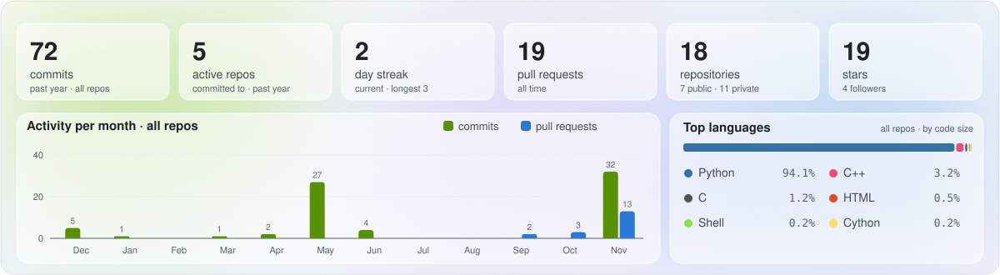

<picture>
  <source media="(prefers-color-scheme: dark)" srcset="assets/banner-dark.svg"/>
  
</picture>

  
  
  
  

I build **computer vision systems that run in real time** — from multi-view geometry to hand-tuned CUDA kernels and TensorRT inference on NVIDIA hardware. My long-term goal: **vision-language-action models on edge devices.**

## 🔨 Now

- ⚡ **CUDA kernels:** writing and benchmarking GEMM and other kernels against the measured limits of an RTX 5060 Ti (Blackwell, `sm_120`)
- 🧊 **SFM → C++/CUDA:** GPU data loading and calibration done; triangulation and bundle adjustment next
- 🌙 **Low-light detection:** data-centric label improvement for a YOLO detector on ExDark (Kaggle)
- 🤖 **Next:** real-time vision-language-action models on edge hardware

<!-- NOW:START -->
Recent public releases and pushes appear here automatically.
<!-- NOW:END -->

## 🚀 Projects

| Project | What it does | |
|---|---|---|
| 🧊 [**SFM**](https://github.com/Sovik-Ghosh/SFM) | Incremental Structure-from-Motion — being rebuilt as a C++/CUDA runtime (FAST/ORB, F-RANSAC, PnP, triangulation, Schur-complement BA) |  |
| 🕸️ [**SelfGNNplus**](https://github.com/Sovik-Ghosh/SelfGNNplus) | Self-supervised GNN recommender with interval-level temporal dependencies — beats SelfGNN + 18 baselines on 4 datasets (up to **+7.5% HR@10**, **+11.7% NDCG@10**) |  |
| 🏋️ [**GymJam**](https://github.com/Sovik-Ghosh/GymJam-AI-assistant-using-mediapipe) | Real-time workout assistant: MediaPipe pose estimation for form feedback |  |
| 🎬 [**Movera**](https://github.com/Sovik-Ghosh/Movera-movie-recommendation-using-RASA) | Conversational movie recommender built with Rasa |  |

**Industry work (private):** TensorRT C++ runtime for industrial line-scan inspection · DeepStream segmentation pipeline on Jetson.

## 🛠️ Stack

  

  
  
  
  
  
  
  
  

<b>Areas of expertise</b>

 

| Area | Topics |
|---|---|
| **3D vision** | Structure from Motion, multi-view geometry, SLAM, visual odometry, bundle adjustment |
| **Perception** | Object detection, semantic segmentation, depth estimation, point clouds |
| **Models** | YOLO, Mask R-CNN, U-Net, PointNet++, SuperGlue, PV-RCNN, PointPillars, Transformers, GNNs |
| **Optimisation** | Quantisation, TensorRT, custom CUDA kernels, distributed training |
| **Robotics** | Sensor fusion, motion planning, control — LiDAR, IMU and camera systems |
| **MLOps & data** | Experiment tracking, model monitoring, Airflow ETL pipelines, CI/CD |

## 🎓 Education

- **MSc Robotics & Artificial Intelligence** — University of Glasgow (2023–2024)
- **BTech Computer Science & Engineering** — MAKAUT (2019–2023)

## 📊 Stats

<picture>
  <source media="(prefers-color-scheme: dark)" srcset="assets/stats-dark.svg"/>
  
</picture>

<a href="#top">↑ back to top</a>

